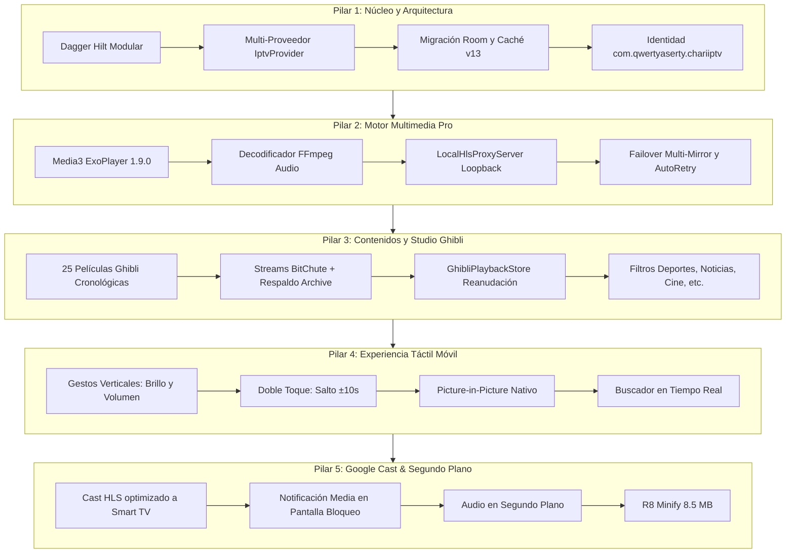

# 📱 Informe de Auditoría y Plan Maestro de Evolución: Chari-IPTV Mobile (Celular)

> **Documento:** Plan Estratégico de Evolución y Homologación Tecnológica  
> **Proyecto Origen:** `C:\xampp\htdocs\Chari-IPTV_TV` (v1.2 — Producción / Jetpack Compose / ExoPlayer 1.9.0)  
> **Proyecto Objetivo:** `C:\xampp\htdocs\Chari-IPTV_Cel` (v1.0 — Prototipo Inicial Móvil)  
> **Fecha:** 23 de Noviembre, 2026  
> **Autor:** Antigravity AI (Google DeepMind) para Qwerty Aserty

---

## Executive Summary (Resumen Ejecutivo)

Habiendo alcanzado la versión de producción **Chari-IPTV v1.2** para Android TV con estabilidad comprobada (catálogo cronológico de 25 películas de Studio Ghibli, reanudación inteligente, proxy anti-bloqueo 403, micro-zapping, Dagger Hilt multi-proveedor y compilación optimizada de 8.48 MB), se realizó una auditoría profunda sobre el repositorio móvil **`Chari-IPTV_Cel`**.

El análisis revela una **brecha generacional crítica**: mientras que la versión TV es una plataforma modular, desacoplada y blindada contra fallos de red, la versión Celular se encuentra en un estado inicial prototípico donde **toda la UI, el reproductor, el grid y la lógica de Cast residen en un único archivo monolítico (`MainActivity.kt` de 500 líneas)**, la descarga de canales analiza torpemente el archivo global `index.m3u` con sondeos HTTP concurrentes que agotan la batería del móvil, carece de decodificación de audio FFmpeg y no integra el catálogo de Studio Ghibli ni las categorías temáticas.

Este informe traza la **hoja de ruta completa** para transformar `Chari-IPTV_Cel` en una aplicación móvil de referencia: rápida, táctil, eficiente en batería/datos, con soporte Picture-in-Picture (PiP), Google Cast optimizado y la experiencia cinematográfica de Studio Ghibli adaptada a smartphones.

---

## 1. Matriz Comparativa: Chari-IPTV TV vs. Chari-IPTV Celular

| Dimensión Técnica | Chari-IPTV TV (v1.2 Producción) | Chari-IPTV Celular (Estado Actual) | Brecha / Diagnóstico |
| :--- | :--- | :--- | :--- |
| **Identificador de Paquete** | `com.qwertyaserty.chariiptv` | `com.example.charyiptv` | Discrepancia de marca (`chary` vs `chari`) y prefijo de ejemplo. |
| **Arquitectura de Código** | Clean Architecture modular (Data, Domain, Presentation, Player, Components). | Monolito: Lógica, UI y Player concentrados en `MainActivity.kt`. | Deuda técnica alta; difícil de mantener y probar. |
| **Ingesta de Canales** | Multi-Proveedor (`IptvProvider`): `IptvOrg`, `TdtChannels`, `PlutoTv`, `AniVod`. Lista optimizada `languages/spa.m3u`. | Descarga masiva del archivo mundial `index.m3u` (+30 MB) con regex en bucle. | Desperdicio masivo de datos móviles y memoria RAM. |
| **Verificación de Señales** | Carga instantánea con caché Room v13 y pre-calentamiento especulativo DNS (DoH). | Bucles `async { isStreamWorking() }` haciendo requests HTTP masivos simultáneos. | Bloqueo temporal por proveedores y consumo agresivo de batería. |
| **Proxy Local Anti-Bloqueos** | `LocalHlsProxyServer` (Loopback 8899) con inyección de `Referer`, `Origin` y anti-SSRF. | ❌ Inexistente. Conexión directa a ciegas. | Falla inmediata (HTTP 403 Forbidden / 451) en señales protegidas. |
| **Motor Multimedia (ExoPlayer)** | Media3 1.9.0 + Decodificador FFmpeg de Audio (AC3, E-AC3, DTS) + Watchdog adaptativo. | Media3 1.2.0 básico sin decodificadores por software. | Películas o canales sin audio en dispositivos que carecen de licencia Dolby. |
| **Catálogo Studio Ghibli** | 25 películas oficiales cronológicas (1984–2023), BitChute + Archive.org. | ❌ Inexistente. | Falta el mayor atractivo cinematográfico del proyecto. |
| **Reanudación de Video** | `GhibliPlaybackStore` + Diálogo modal para reanudar o reiniciar desde 0:00. | ❌ Inexistente. | No hay persistencia de progreso temporal. |
| **Interacción y Gestos** | Navegación pura D-Pad 10-Foot UI (Control Remoto). | Clic táctil simple sobre tarjetas de 100dp. | Faltan gestos móviles (brillo, volumen, búsqueda ±10s, swipe de canal). |
| **Google Cast (Chromecast)** | Receptor de intenciones. | Implementado con `CastContext`, pero con metadata `video/mp4` rígida. | Requiere afinación para retransmitir streams HLS (`.m3u8`) a la TV. |
| **Picture-in-Picture (PiP)** | N/A (TV no lo requiere). | ❌ Inexistente. | Imprescindible para ver TV mientras se usan otras apps en el móvil. |
| **Optimización de Compilación** | R8 Minify + ShrinkResources (8.48 MB). | Minify desactivado (`isMinifyEnabled = false`, ~25 MB). | Binario pesado y sin ofuscación de seguridad. |

---

## 2. Diagnóstico Técnico Detallado de `Chari-IPTV_Cel`

### 2.1 El Problema de Ingesta y Agotamiento de Recursos en Móvil
En [ChannelRepository.kt](file:///C:/xampp/htdocs/Chari-IPTV_Cel/app/src/main/java/com/example/chariiptv/domain/ChannelRepository.kt#L61-L108):
```kotlin
// PROBLEMA ACTUAL: Descarga mundial y verificación concurrente destructiva
val response = apiService.getGlobalM3u() // Descarga decenas de megabytes
...
val workingChannels = uniqueChannels.map { channel ->
    async {
        if (isStreamWorking(channel.url)) channel else null // Decenas de peticiones HTTP simultáneas
    }
}.awaitAll().filterNotNull()
```
* **Impacto en Smartphone:** Si un usuario abre la app con conexión de datos móviles 4G/5G, esta operación puede consumir cientos de megabytes en segundo plano solo para verificar si las emisiones responden. En conexiones lentas, el usuario experimenta un spinner de carga infinito.
* **Solución de la TV:** Adoptar la arquitectura de `Chari-IPTV_TV` que consulta listas especializadas en español (`languages/spa.m3u`), parsea instantáneamente sin sondeos destructivos, almacena en Room Database con timestamp y resuelve el socket en el momento exacto en que el usuario toca el canal.

### 2.2 Monolito en `MainActivity.kt`
Actualmente, [MainActivity.kt](file:///C:/xampp/htdocs/Chari-IPTV_Cel/app/src/main/java/com/example/chariiptv/MainActivity.kt) contiene:
* La inicialización de la actividad y permisos.
* El listener de Google Cast.
* El layout completo de la pantalla principal (`Scaffold`, `TopBar`, `ScrollableTabRow`).
* El componente `ChannelGrid` con tarjetas cuadradas y emojis de texto.
* La lógica de alerta para escanear canales.
* La instanciación cruda de `ExoPlayerView` embebida con un `AndroidView`.

Esta estructura bloquea la extensibilidad, dificulta incorporar la vista cinematográfica de Studio Ghibli y hace imposible crear pruebas unitarias de UI.

---

## 3. Plan Maestro de Evolución: Los 5 Pilares de Modernización



---

## 4. Especificaciones de Implementación por Fase

### Fase 1: Arquitectura de Red, Repositorios y Homologación de Marca
1. **Homologación de Identidad:**
   * Cambiar `applicationId` en `app/build.gradle.kts` a `com.qwertyaserty.chariiptv` (o `com.qwertyaserty.chariiptv.mobile` según preferencia).
   * Unificar el nombre de la app como **`Chari-IPTV`**.
2. **Capa Multi-Proveedor:**
   * Trasladar el paquete `domain.provider` de la versión TV:
     * `IptvProvider.kt` (contrato desacoplado).
     * `IptvOrgProvider.kt` (ingesta optimizada de señales hispanas).
     * `TdtChannelsProvider.kt` (canales de España en alta definición).
     * `PlutoTvProvider.kt` (canales 24/7 de entretenimiento).
     * `AniVodProvider.kt` (catálogo dedicado de Studio Ghibli).
     * `M3uParser.kt` (parser optimizado de alto rendimiento).
3. **Caché Persistente con Room:**
   * Migrar la base de datos local para guardar canales por categoría y país sin obligar a la re-descarga continua.
4. **DNS-over-HTTPS (DoH) y Anti-Censura:**
   * Configurar en `AppModule.kt` el cliente seguro con Cloudflare DoH (`1.1.1.1`) y Google DNS (`8.8.8.8`) para superar bloqueos de proveedores móviles en partidos en directo.

---

### Fase 2: Motor de Video de Nueva Generación y Proxy Loopback
1. **Actualización de ExoPlayer y Jellyfin FFmpeg:**
   * Subir dependencias a `androidx.media3:1.9.0`.
   * Incorporar la librería `media3-ffmpeg-decoder` para dotar al móvil de decodificación completa de audio multicanal (AC3, E-AC3, DTS) sin depender del hardware del teléfono.
2. **Micro-Proxy HLS Embebido (`LocalHlsProxyServer.kt`):**
   * Incorporar el microservidor local HTTP en `127.0.0.1:8899`.
   * Cuando una emisión sufra `HTTP 403 Forbidden` o bloqueo de cabecera (`Referer` / `Origin`), ExoPlayer conmuta al proxy local automáticamente.
3. **Watchdog y Reconexión Automática:**
   * Implementar la política de 3 reintentos continuos informando en pantalla *"Reconectando señal (intento X de 3)..."* antes de dar una señal por caída.

---

### Fase 3: Catálogo Studio Ghibli (25 Películas) y Reanudación Móvil
1. **Incorporación de `GhibliData.kt` y `AniVodProvider.kt`:**
   * Colección completa de las 25 películas oficiales (1984–2023) desde *Nausicaä del Valle del Viento* hasta *El chico y la garza*.
   * Streams de alta velocidad en BitChute con respaldo en Internet Archive en `alternateSources`.
2. **Sistema de Reanudación Táctil (`GhibliPlaybackStore`):**
   * Persistencia en `SharedPreferences` de la posición de reproducción (ms).
   * Al tocar una película previamente vista, despliega un *BottomSheet* o diálogo táctil centrado:
     * **[Continuar en 01:24:15]**
     * **[Empezar desde el inicio]**
3. **Categorías Temáticas en el Menú Superior/Inferior:**
   * Añadir filtros rápidos: **Deportes, Noticias, Películas, Series, Infantil, Música, Países y Studio Ghibli**.

---

### Fase 4: Experiencia de Usuario Adaptada a Smartphones (Mobile UX)

A diferencia de la TV (donde todo se maneja con D-Pad), el teléfono móvil exige una experiencia táctil intuitiva:

```
┌────────────────────────────────────────────────────────┐
│                   REPRODUCTOR MÓVIL                    │
├──────────────────────────┬─────────────────────────────┤
│ 🔆 Deslizar Arriba/Abajo │ 🔊 Deslizar Arriba/Abajo    │
│    (Mitad Izquierda)     │    (Mitad Derecha)          │
│    -> Ajustar Brillo     │    -> Ajustar Volumen       │
├──────────────────────────┴─────────────────────────────┤
│ ⏪ Doble toque: -10s     │ ⏩ Doble toque: +10s        │
├────────────────────────────────────────────────────────┤
│ [⛶ PiP]    [📺 Cast]    [⚙️ Aspecto]    [🔒 Bloqueo]   │
└────────────────────────────────────────────────────────┘
```

1. **Gestos Táctiles en Pantalla Completa:**
   * **Mitad izquierda de la pantalla:** Deslizar verticalmente para subir/bajar el brillo de la pantalla.
   * **Mitad derecha de la pantalla:** Deslizar verticalmente para subir/bajar el volumen multimedia.
   * **Doble toque lateral:** Adelantar o retroceder 10 segundos (especialmente útil en Studio Ghibli).
   * **Pellizcar para zoom (Pinch to Zoom):** Alternar entre modo *Ajustar a pantalla*, *Recortar (16:9)* o *Estirar*.
2. **Picture-in-Picture (PiP) Nativo:**
   * Al pulsar el botón Home del teléfono o cambiar de app mientras se reproduce un canal, la app pasa a una ventana flotante pequeña en la esquina de la pantalla.
3. **Buscador de Canales en Vivo (Search Bar):**
   * Un campo de búsqueda instantáneo en la parte superior para escribir el nombre de cualquier canal o película y filtrar en milisegundos.
4. **Diseño de Interfaz "Obsidian Mobile":**
   * Reemplazar las tarjetas de 100dp con tarjetas estilizadas con esquinas redondeadas, logos transparentes en alta definición y badges temáticos.

---

### Fase 5: Google Cast Mejorado y Optimización de Producción
1. **Afinación de Google Cast:**
   * Adaptar `CastOrLocalPlayerView` para detectar si el canal es una transmisión HLS (`application/x-mpegURL`) o video MP4 (`video/mp4`), enviando los tipos MIME exactos al dispositivo Chromecast o Android TV receptor.
2. **Reproducción con Pantalla Apagada (Modo Radio/Noticias):**
   * Permitir que canales de música o noticias continúen sonando como servicio en segundo plano con controles en la barra de notificaciones del móvil.
3. **Compilación R8 de Producción:**
   * Activar `isMinifyEnabled = true` y `isShrinkResources = true`.
   * Incluir las reglas ProGuard de la versión TV para reducir el APK de 25 MB a **~8.5 MB**.

---

## 5. Cronograma Recomendado de Ejecución

```
Semana 1 ────> [Fase 1: Multi-Proveedor, Room & AppModule]
Semana 2 ────> [Fase 2: ExoPlayer 1.9.0, FFmpeg Audio & Local Proxy]
Semana 3 ────> [Fase 3: 25 Películas Ghibli & Reanudación]
Semana 4 ────> [Fase 4: Gestos Táctiles, PiP & Buscador]
Semana 5 ────> [Fase 5: Google Cast Pro & Release R8 APK]
```

---

## 6. Conclusión y Recomendación

El código actual de **Chari-IPTV TV (v1.2)** representa más de un 80% del trabajo de ingeniería avanzado que le falta a la versión móvil (control de errores, streaming híbrido, proxy local, decodificación de audio, arquitectura multi-proveedor y catálogo curado de Studio Ghibli).

Portar estas soluciones al proyecto `Chari-IPTV_Cel` y complementarlas con las funciones táctiles clave para smartphones (**PiP, control por gestos y buscador**) convertirá a la aplicación móvil en el compañero perfecto de la versión de sala de estar.
