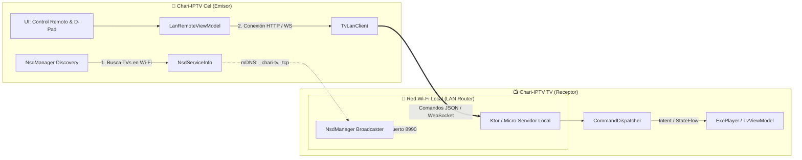
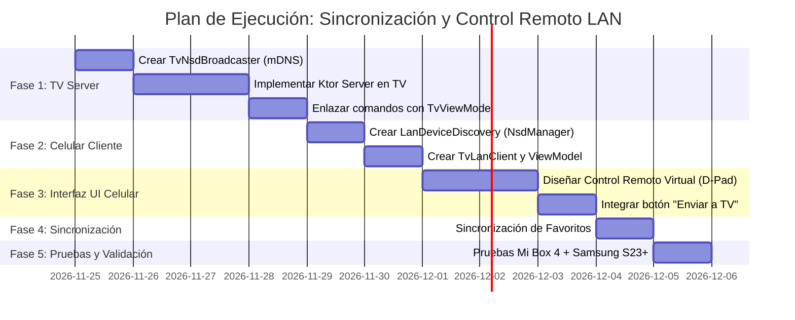

# 📡 Plan de Arquitectura e Implementación: Sincronización y Control Remoto LAN Directo

> **Proyecto:** Chari-IPTV (Ecosistema Celular & Android TV)  
> **Versión del Plan:** 1.0.0  
> **Ubicación:** `C:\xampp\htdocs\Chari-IPTV_Cel\PLAN_IMPLEMENTACION_CONTROL_REMOTO_LAN.md`  
> **Enfoque:** Comunicación directa local P2P (Wi-Fi) sin intermediarios, 100% gratuita, de baja latencia y sin dependencias de servicios en la nube de Google.

---

## 1. Visión General y Objetivos

El objetivo de esta solución es interconectar la aplicación móvil (**Chari-IPTV Cel**) con la aplicación de televisión (**Chari-IPTV TV**) cuando ambos dispositivos se encuentran en la misma red Wi-Fi, permitiendo:

1. **"Enviar a TV" con un solo toque:** El usuario selecciona cualquier canal en el celular y la televisión sintoniza la transmisión al instante mediante su reproductor nativo (ExoPlayer), evitando los bloqueos de CORS del receptor web de Chromecast.
2. **Control Remoto Táctil Virtual:** El celular se convierte en un mando a distancia interactivo con cruceta direccional (D-Pad: Arriba, Abajo, Izquierda, Derecha, OK, Atrás, Inicio), control de volumen y teclado móvil para búsquedas rápidas.
3. **Sincronización Bidireccional de Favoritos:** La lista de canales favoritos se mantiene idéntica en ambos dispositivos sin necesidad de crear cuentas ni bases de datos en la nube.
4. **Estado en Tiempo Real:** El celular muestra lo que se está viendo en la TV (nombre del canal, carátula, estado de reproducción).

---

## 2. Arquitectura de Comunicación en Red Local



### Protocolo de Transporte:
* **Descubrimiento:** `mDNS / DNS-SD` (Network Service Discovery oficial de Android) bajo el tipo de servicio `_chari-tv._tcp`. No requiere que el usuario conozca o escriba direcciones IP.
* **Canal de Comandos:** Peticiones HTTP REST (`POST /api/command`) con respuestas JSON inmediatas (< 50 ms).
* **Canal de Estado en Vivo:** WebSocket bidireccional (`/ws/status`) para reflejar en el celular volumen, canal actual y eventos de reproducción en tiempo real.

---

## 3. Especificación del Protocolo de Mensajería JSON

### 3.1. Enviar Canal a la TV (`PLAY_CHANNEL`)
**Origen:** Celular ➔ **Destino:** TV  
**Endpoint:** `POST http://<IP_TV>:8990/api/command`
```json
{
  "action": "PLAY_CHANNEL",
  "channel": {
    "name": "America Television (1080p)",
    "url": "https://...",
    "logo": "https://.../america.png",
    "category": "peru",
    "referer": "",
    "userAgent": ""
  }
}
```
**Respuesta TV:**
```json
{
  "status": "OK",
  "message": "Sintonizando canal",
  "currentChannel": "America Television (1080p)"
}
```

---

### 3.2. Emulación de Control Remoto (`KEY_EVENT`)
**Origen:** Celular ➔ **Destino:** TV  
**Endpoint:** `POST http://<IP_TV>:8990/api/remote`
```json
{
  "action": "KEY_EVENT",
  "key": "DPAD_UP" // Valores: DPAD_UP, DPAD_DOWN, DPAD_LEFT, DPAD_RIGHT, DPAD_CENTER, BACK, HOME, VOL_UP, VOL_DOWN, MUTE, PLAY_PAUSE
}
```

---

### 3.3. Sincronización de Favoritos (`SYNC_FAVORITES`)
**Origen:** Celular ➔ **Destino:** TV  
**Endpoint:** `POST http://<IP_TV>:8990/api/favorites`
```json
{
  "action": "SYNC_FAVORITES",
  "favorites": [
    "https://canal1.m3u8",
    "https://canal2.m3u8"
  ]
}
```

---

### 3.4. Envío de Texto para Búsqueda (`INPUT_TEXT`)
Permite escribir en el celular y que el texto aparezca directamente en el buscador de la tele:
```json
{
  "action": "INPUT_TEXT",
  "text": "Studio Ghibli"
}
```

---

## 4. Componentes a Implementar en `Chari-IPTV_TV` (Servidor)

### 4.1. Dependencias Gradle (`build.gradle.kts` de la app de TV)
```kotlin
// Servidor local embebido y serialización ligera
implementation("io.ktor:ktor-server-core:2.3.9")
implementation("io.ktor:ktor-server-cio:2.3.9")
implementation("io.ktor:ktor-server-content-negotiation:2.3.9")
implementation("io.ktor:ktor-serialization-kotlinx-json:2.3.9")
implementation("io.ktor:ktor-server-websockets:2.3.9")
implementation("org.jetbrains.kotlinx:kotlinx-serialization-json:1.6.3")
```

### 4.2. Módulos Clave:
1. **`TvNsdBroadcaster.kt`:**
   * Utiliza `NsdManager` de Android para registrar el servicio `Chari-TV-<Modelo>` en el puerto `8990`.
   * Se activa al iniciar la aplicación de TV y se cancela en `onDestroy()`.
2. **`TvHttpServerService.kt`:**
   * Servicio en segundo plano que levanta Ktor CIO en el puerto `8990`.
   * Expone los endpoints `/api/command`, `/api/remote`, `/api/favorites` y el WebSocket `/ws/status`.
3. **`RemoteCommandReceiver.kt`:**
   * Recibe el JSON y ejecuta la acción en el hilo principal (`Dispatchers.Main`):
     * Si recibe `PLAY_CHANNEL`, llama a `viewModel.playChannel(channel)` en el reproductor nativo.
     * Si recibe `KEY_EVENT`, inyecta el evento de teclado mediante `Instrumentation` o mediante eventos en Compose (`FocusManager`).
     * Si la app estaba en segundo plano, la trae al frente con `Intent.FLAG_ACTIVITY_REORDER_TO_FRONT`.

---

## 5. Componentes a Implementar en `Chari-IPTV_Cel` (Cliente / Mando)

### 5.1. Módulos Clave:
1. **`LanDeviceDiscovery.kt`:**
   * Escucha servicios `_chari-tv._tcp` usando `NsdManager.discoverServices()`.
   * Mantiene una lista reactiva (`StateFlow<List<DiscoveredTv>>`) con las televisiones conectadas en la casa (Nombre, IP y Puerto).
2. **`TvLanClient.kt`:**
   * Utiliza el `OkHttpClient` ya inyectado en la app para enviar comandos HTTP y conectar el WebSocket de estado.
3. **`LanRemoteViewModel.kt`:**
   * Administra la televisión actualmente seleccionada, el estado de conexión y el historial de acciones.
4. **Componentes UI (Jetpack Compose):**
   * **`TvDevicePickerModal.kt`:** Diálogo accesible desde la barra superior que muestra las televisiones disponibles ("Mi Box en Sala", "Smart TV Dormitorio").
   * **`VirtualRemoteSheet.kt`:** Panel inferior desplegable con:
     * D-Pad circular táctil con vibración háptica suave (`HapticFeedbackType.LongPress`).
     * Botones de navegación (Atrás, Inicio, Menú).
     * Control deslizante de volumen de la tele.
     * Teclado rápido para enviar búsquedas.
   * **Botón "Ver en TV" en tarjetas de canal:** Acceso directo para mandar cualquier canal a la TV sin reproducirlo primero en el celular.

---

## 6. Seguridad y Resiliencia en Red

1. **Restricción de Subred RFC 1918 (Anti-SSRF):**
   * El servidor de la TV solo acepta peticiones que provengan de rangos privados locales (`192.168.0.0/16`, `10.0.0.0/8`, `172.16.0.0/12`). Peticiones de IPs públicas se descartan inmediatamente.
2. **Emparejamiento por PIN (Opcional configurable):**
   * La primera vez que un celular se conecta, la TV puede mostrar un código PIN de 4 dígitos en pantalla que el usuario ingresa en el celular para generar un token de sesión permanente.
3. **Auto-Reconexión:**
   * Si el celular pierde señal Wi-Fi momentáneamente, el cliente intenta reconectarse de forma silenciosa cada 3 segundos sin congelar la interfaz.

---

## 7. Cronograma Técnico de Implementación



---

## 8. Conclusiones y Beneficios

* **Independencia absoluta:** Cero costos de infraestructura o de licencias de Google Cast Developer Console.
* **Rendimiento superior:** Al reproducirse en la TV mediante `Chari-IPTV_TV` de forma nativa:
  * No hay consumo de batería en el celular durante la visualización.
  * No se requieren servidores proxy locales para solventar problemas de CORS.
  * La decodificación por hardware de la tele se aprovecha al 100% mediante ExoPlayer.
* **Experiencia de usuario moderna:** Combina la facilidad de buscar contenido en la pantalla táctil del móvil con la comodidad de ver en la pantalla grande de la sala.
